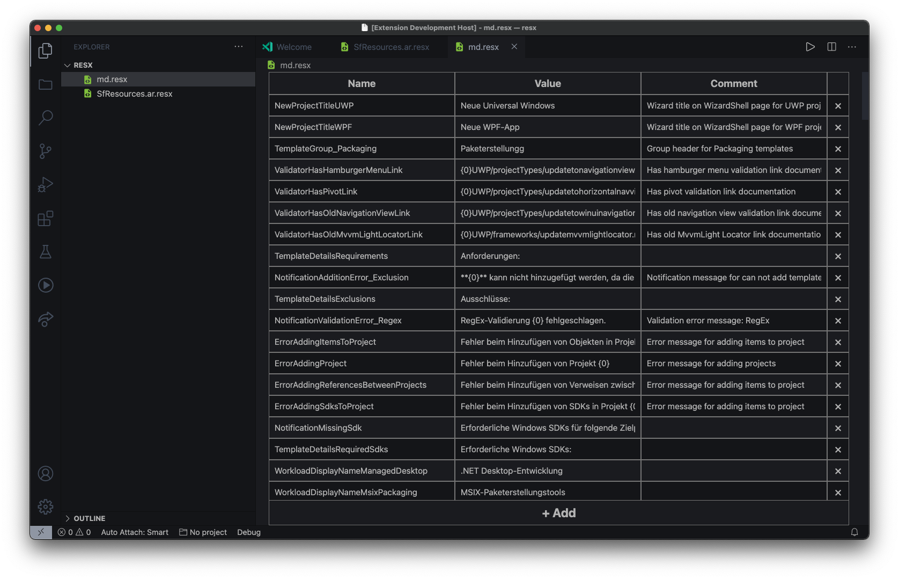

# ResX Editor

A visual editor for .resx files  

## Editing resources

Open a `.resx` or `.resw` file to use the table editor. Sibling language files in the same directory are grouped automatically: `Resources.resx`, `Resources.nl.resx` and `Resources.zh-Hant.resx` appear as separate columns with rows matched by key. Other resource families stay separate.

- Add a resource, enter its key in the desired file column; the entry is added as you type. Empty values and comments are saved.
- Values and comments support multiple lines. Existing whitespace and unrelated XML (including headers and typed/binary resources) are preserved.
- A missing translation appears empty. Enter a value or enter the key in that column to create it in that file.
- Keys are renamed and entries deleted per file. Typed/binary resources are read-only; use XML to edit those.
- Search matches keys, values and comments across all displayed files.
- Changes use VS Code's normal document editing, undo and save behavior. Save each changed file or use **Save All**.

Enable **ResX › Sort On Save** (`"resx.sortOnSave": true`) to order resource entries alphabetically by key. This is off by default to avoid reordering existing files unexpectedly.

## Git changes and XML

Choose **ResX: Compare with Git HEAD** from a resource file's Explorer, editor tab or Source Control context menu, or click **Compare with Git HEAD** in the editor.

The read-only Git view matches entries by key and shows added, removed and changed values and comments side by side. Search filters the changes; **Show unchanged entries** includes matching entries. It compares a snapshot of HEAD with the working document, including unsaved edits, and updates as that document changes. Reopen the view after changing HEAD. New/untracked files are compared with an empty resource set. Local Git repositories and VS Code's built-in Git extension are required. Staged changes are included in the comparison with the working file, rather than shown as a separate revision.

**Open XML Diff** shows the full text comparison, including formatting, attributes, typed resources and metadata that the resource view does not compare. **Open as XML** in the editor, or **ResX: Open as XML** in the file context menu, opens the underlying XML. VS Code's **Reopen Editor With… → Text Editor** also works.

## Development

Use Node.js 18 or newer, `npm ci`, `npm run test:unit` and `npm run lint`. `npm test` runs integration tests in VS Code 1.95.3; on Linux without a display, use `xvfb-run -a npm test`.

